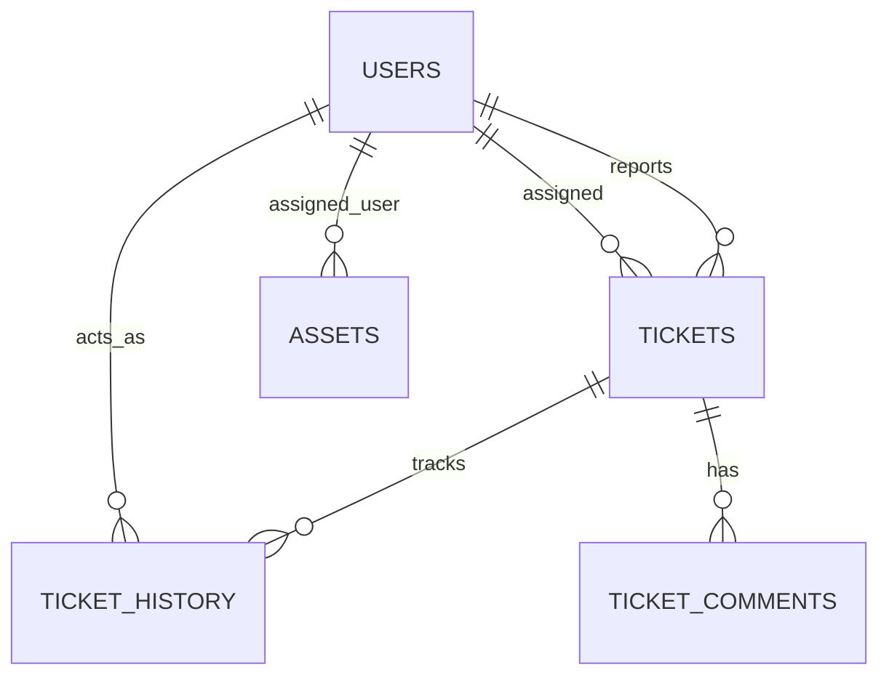

# IT Helpdesk & Asset Management System

An educational portfolio project: a containerized Spring Boot IT help desk and asset management web application. It is a single deployable application (not a microservice system) using Java 17, Spring Boot, Thymeleaf, Spring Data JPA, MySQL, Flyway, Redis caching, and Spring Security with BCrypt.

---

## Key Features & Recent Improvements

### Containerized Quick Start
1. Copy `.env.example` to `.env` and set unique local values for `DB_PASSWORD` and `MYSQL_ROOT_PASSWORD` (the application and MySQL user use the same `DB_PASSWORD`). Never commit `.env`.
2. Start the app, MySQL, and Redis with:

```bash
docker compose up --build
```

The app is available at [http://localhost:8080](http://localhost:8080); health is at [http://localhost:8080/actuator/health](http://localhost:8080/actuator/health). MySQL is not published to the host by default; use `docker compose -f docker-compose.yml -f docker-compose.debug.yml up --build` only when local DB access is needed. The `helpdesk_mysql` volume persists database data. `docker compose down` preserves it; `docker compose down -v` deletes it.

See [docker/README.md](docker/README.md) for configuration, health checks, test/build behavior, and troubleshooting.

### 1. Complete Ticket Editing & Protection (Phase 2)
- **Edit Existing Tickets**: Permitted users can update existing tickets without creating duplicates (`GET /tickets/{id}/edit`, `POST /tickets/{id}/edit`).
- **Data Integrity**: Preserves original ticket ID, reporter, and creation timestamp. The `updatedAt` timestamp is updated automatically via JPA `@PreUpdate` lifecycle triggers and service timestamps.
- **Dedicated Form DTO (`TicketEditForm`)**: Protects against Mass Assignment vulnerabilities. Sensitive internal fields (such as reporter ID and timestamps) are never bound directly from incoming HTTP form parameters.
- **Graceful Error Handling**: Nonexistent ticket IDs return an enterprise-styled 404 page rather than exposing stack traces.

### 2. Role-Based Permissions & Authorization Matrix
Security rules are enforced on the backend service layer and via Spring Security request matchers:

| Capability | Employee | Technician | Rule Enforcement |
|---|---|---|---|
| View Ticket List | **Denied** | All organization tickets | `SecurityConfig` |
| View Ticket Details | Own ticket progress only | All organization tickets | `SecurityConfig` + owner-scoped repository lookup |
| Create Tickets | Allowed (starts `OPEN`) | Allowed | `TicketService.create` |
| Edit Title, Desc, Category, Priority | **Denied** | Allowed | `TicketService.updateTicket` |
| Assign / Reassign Technicians | **Denied** (HTTP tampering blocked) | Allowed | `TicketService.assign` & `SecurityConfig` |
| Change Ticket Status | **Denied** (HTTP tampering blocked) | Allowed (valid workflow states) | `TicketService.updateStatus` |
| Enter Resolution Notes | **Denied** | Required when `RESOLVED`/`CLOSED` | Server validation |
| Manage Assets (Add/Edit/Unassign) | **Denied** | Full management | `SecurityConfig` & `AssetService` |

Employees have a focused submission and tracking experience: after sign-in they land on the create-ticket form, can track only their own tickets at `/my-tickets`, and receive a direct progress link after submission. Direct requests to the dashboard, full technician queue, ticket management endpoints, and all asset routes are denied.

### 3. Comprehensive Audit Trail & Activity History (Phase 3)
- Whenever a ticket is updated (title, description, category, priority, technician assignment, status transition, or resolution notes), an audit entry is recorded in `ticket_history`.
- Stores: `ticket_id`, `actor_id`, `action`, `details`, `field_changed`, `previous_value`, `new_value`, and `created_at`.
- Displays chronologically on the ticket detail page with clear "before and after" diff pills.
- Database evolved cleanly using Flyway migration `V2__audit_fields.sql`.

### 4. Technician Workflow & Live Metrics (Phase 4)
- **Multi-Criteria Filtering**: Filter tickets by status, priority, category, unassigned status, and keyword search.
- **Quick Actions**: Assign or reassign tickets directly from the ticket detail page with team history tracking.
- **Real-Time Operational Metrics**: Dashboard aggregates live counts from the database:
  - Open, In Progress, Resolved/Closed counts
  - High-Priority urgent queue
  - Unassigned ticket count
  - Personal queue ("My Active Assignments")
  - Registered asset count

### 5. Complete Asset Management (Phase 5)
- **Edit Existing Equipment**: Update asset tags, model name, category, manufacturer, serial number, purchase date, notes, and operational status (`GET /assets/{id}/edit`, `POST /assets/{id}/edit`).
- **Assignment & Unassignment**: Assign equipment directly to active employees; unassign equipment back into storage with a single click.
- **Duplicate Tag Protection**: Validates unique asset tags while allowing updates to the current asset (`existsByAssetTagAndIdNot`).
- **Business Rule Validation**: Prevents assigning retired equipment to users; retiring an asset automatically unassigns it.
- **Ticket conversation**: Employees can comment on tickets they own; technicians can reply or add technician-only internal notes.
- **Paged lists and edit conflict protection**: Technician ticket/asset queues and employee tracking are server paginated. Technician edits carry a JPA optimistic-lock version and stale forms receive HTTP 409.
- **Philippine display time**: Application timestamps are stored as UTC and formatted for users in Philippine Time (PHT).
- **Graceful Redis degradation**: Cache failures are logged and ignored so dashboard metrics continue using database queries.

---

## Architecture & Data Model



- **Controller Layer**: Handles HTTP routing, model binding, and flash messages.
- **Service Layer (`TicketService`, `AssetService`)**: Enforces all business rules, role-based authorization, and transactional consistency (`@Transactional`).
- **Data Layer (`Spring Data JPA`)**: Repository interfaces with parameterized JPQL queries.
- **Database Migrations (`Flyway`)**:
  - `V1__init.sql`: Base tables (`users`, `tickets`, `assets`, `ticket_history`, indexes).
  - `V2__audit_fields.sql`: Added `field_changed`, `previous_value`, and `new_value` audit columns.
  - `V3__ticket_comments_and_optimistic_lock.sql`: Adds comments and optimistic-lock versioning.

---

## Application Routes

| Method | Endpoint | Role | Description |
|---|---|---|---|
| `GET` | `/` | Technician | Operations Dashboard with live metrics; employees are redirected to ticket creation |
| `GET` | `/tickets` | Technician | Search & filter support tickets |
| `GET` | `/tickets/new` | Authenticated | Focused support ticket creation form |
| `POST` | `/tickets` | Authenticated | Create a new ticket; employees return to the creation form |
| `GET` | `/tickets/{id}` | Technician | Ticket detail page and chronological audit feed |
| `GET` | `/my-tickets` | Employee | List of the signed-in employee's submitted tickets |
| `GET` | `/my-tickets/{id}` | Employee | Owner-checked ticket progress and status history |
| `GET` | `/tickets/{id}/edit` | Technician | Edit ticket form (prefilled with current values) |
| `POST` | `/tickets/{id}/edit` | Technician | Submit updates to an existing ticket |
| `POST` | `/tickets/{id}/status` | Technician | Quick status transition with resolution notes |
| `POST` | `/tickets/{id}/assign` | Technician | Quick technician assignment |
| `GET` | `/assets` | Technician | Asset inventory list with search and filters |
| `GET` | `/assets/new` | Technician | Register new equipment |
| `POST` | `/assets` | Technician | Save new equipment |
| `GET` | `/assets/{id}/edit` | Technician | Edit existing equipment details |
| `POST` | `/assets/{id}/edit` | Technician | Save changes to equipment |
| `POST` | `/assets/{id}/unassign`| Technician | Unassign equipment back to storage |
| `GET` | `/login` | Public | Authentication page |
| `GET` | `/register` | Public | Employee self-registration |

---

## Running the Application Locally

### Prerequisites
- JDK 17+
- Maven 3.8+
- Docker (optional, for MySQL)

### Option 1: Quick Demo with H2 (No Docker required)
```bash
mvn spring-boot:run -Dspring-boot.run.profiles=h2
```
Access the application at [http://localhost:8080](http://localhost:8080).

### Option 2: Containerized app, MySQL, and Redis
```bash
cp .env.example .env
# Edit .env and set unique DB_PASSWORD and MYSQL_ROOT_PASSWORD values.
docker compose up --build
```

For local development against MySQL on the host, activate the `dev` profile and provide `DB_PASSWORD`; the Compose app uses the `prod` profile and service DNS names.

### Optional local demo accounts

Seed accounts are created only when the explicit `demo` profile is active. For a local H2 demo, use:

```bash
mvn spring-boot:run -Dspring-boot.run.profiles=h2,demo
```

These credentials are for local demonstration only; do not enable the demo profile in a public deployment.

- **Employee**: `employee` / `employee123`
- **Technician**: `technician` / `technician123`

---

## Automated Test Suite

Run all automated unit and integration tests:
```bash
mvn verify
```

The suite covers the employee and technician authorization boundaries, ticket submission and validation, ownership-safe tracking, ticket filtering and workflow rules, audit history, and asset management. Testcontainers exercises Flyway migrations and Redis cache eviction with MySQL/Redis when Docker is available; those tests are skipped if Docker is unavailable. Browser-flow coverage can be enabled with `mvn verify -Dbrowser.tests=true` (requires Chrome/Chromium and Docker for the container-backed tests). CI runs the browser flow, Maven verification, and builds the container image.

### Screenshots and known limitations

The screenshots below are captured from the current employee tracking and technician ticket-detail flows. The application is a single Spring Boot deployable with Redis as an optional cache; it is not split into independently deployed microservices. CI builds but does not publish an image or deploy it. The automated browser test is opt-in locally and enabled in CI; no hosted deployment is configured.

### Key Test Coverage Areas:
1. **Ticket Editing (`TicketServiceTest`)**:
   - Employees cannot reach ticket editing routes; technicians can edit ticket details.
   - Ticket ID, reporter, and creation timestamp remain immutable during technician edits.
   - Updated timestamp changes automatically when a technician saves an update.
   - Invalid titles or missing required fields are rejected.
   - Nonexistent ticket returns `ResourceNotFoundException`.
   - Ticket creation binds only employee-editable fields and sets reporter/status on the server.
2. **Security & Authorization (`TicketWebSecurityIntegrationTest`)**:
   - Unauthenticated users redirected to `/login`.
   - Employees can access ticket creation only and receive HTTP 403 for ticket queue/details/edit and all asset pages.
   - The dashboard entry redirects employees to ticket creation.
   - Technicians retain access to ticket and asset management.
   - Technician can assign and resolve tickets with required notes.
3. **Workflow & History Auditing**:
   - Changing status records `STATUS_CHANGED` with previous and new values.
   - Updating details records specific field changes (`title`, `description`, `category`, `priority`, `technician`).
   - Resolving a ticket without resolution notes is rejected with `IllegalArgumentException`.
   - Reopening and closed-ticket validation rules enforced.
4. **Asset Management (`AssetServiceTest`)**:
   - Asset editing preserves existing tags without false-positive collision errors.
   - Duplicate tags across different assets are rejected.
   - Retired assets cannot be assigned to users.
   - Equipment assignment and unassignment updates status appropriately.

---

## Manual Browser Testing Walkthrough

Follow these steps to manually test the ticket editing and permission workflow:

1. **Test Employee Ticket Submission**:
   - Log in as `employee` / `employee123`.
   - Submit a ticket titled *"Laptop Wi-Fi drops intermittently"*.
   - Verify the confirmation includes a direct progress link and that the page does not expose links to the dashboard, full ticket queue, or assets.
   - Open **My Tickets** and verify the submitted ticket appears with its status timeline.
2. **Test Employee Permission Boundaries**:
   - While signed in as `employee`, try `/`, `/tickets`, `/tickets/{another employee's ticket ID}`, and `/assets` directly.
   - Verify the dashboard redirects to ticket creation, full queue and asset pages return **HTTP 403**, and a non-owned `/my-tickets/{id}` returns **HTTP 404**.
3. **Test Technician Workflow & Status Updates**:
   - Sign out and log in as `technician` / `technician123`.
   - Go to **Tickets**. Notice you can view all tickets submitted by employees.
   - Open the ticket created in Step 1.
   - In the **Quick Workflow Actions** panel:
     - Select a technician from the **Assign Technician** dropdown and click **Update Assignment**.
     - Verify the ticket updates with the assignee name and the action is recorded in history.
     - Try changing the status to `RESOLVED` with empty notes: verify you are prompted that resolution notes are required.
     - Add resolution notes *"Replaced internal Wi-Fi 6 card and updated Intel drivers."* and click **Update Status**.
     - Verify the status badge updates to `RESOLVED` and resolution notes are cleanly displayed.
4. **Test Asset Editing & Assignment**:
   - Navigate to **Assets** and click **＋ Add asset**.
   - Register a laptop: Tag `LAP-2024-08`, Name `MacBook Pro 14`, Category `Laptop`. Assign it to `employee`.
   - Click **Save Asset**. Verify the status shows `ASSIGNED` to `Demo Employee`.
   - Click **✎ Edit** on the new asset. Change the name or operational status. Verify it updates without duplicate tag errors.
   - Click **Unassign**: confirm prompt, and verify the asset status changes to `AVAILABLE` with `Unassigned` badge.

---

## Known Limitations & Future Enhancements
- **Attachment uploads**: File uploads (screenshots/system logs) could be integrated with AWS S3 or local directory storage.
- **Email notifications**: Async JavaMailSender integration for email alerts on ticket assignment and status resolution.

---

## Application UI Walkthrough

### Employee Ticket Progress (`GET /my-tickets/{id}`)
Owner-scoped ticket tracking with a clear status timeline, PHT timestamps, priority, request details, and public conversation.


### Technician Ticket Detail (`GET /tickets/{id}`)
Technician status and resolution controls, assignment form, and chronological activity history.


