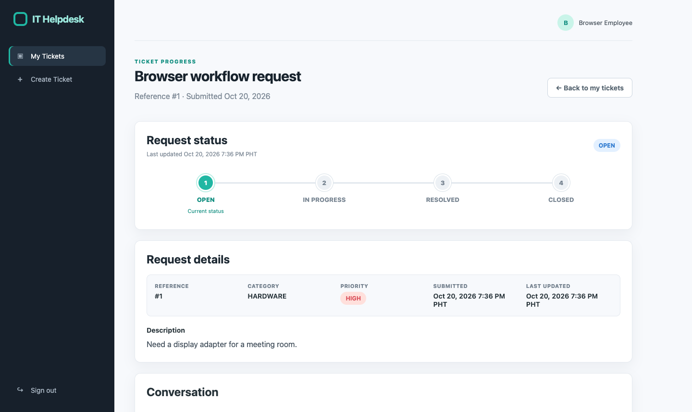
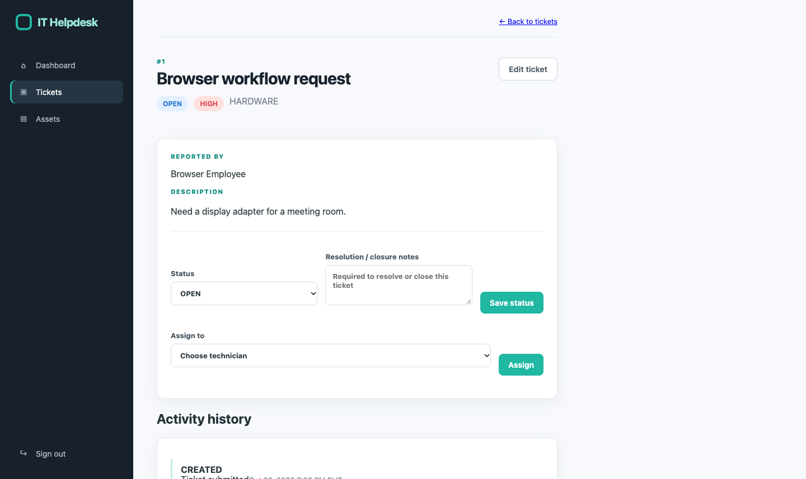

# IT Helpdesk & Asset Management System

An educational portfolio project: a containerized Spring Boot IT help desk and asset management application. It is a single deployable application, not a microservice system, using Java 17, Spring Boot, Thymeleaf, Spring Data JPA, MySQL, Flyway, Redis, Spring Security, and BCrypt.

## Quick Start

1. Copy .env.example to .env.
2. Replace the database and JWT placeholder values with unique local secrets. Never commit .env.
3. Run:

   ~~~bash
   docker compose up --build
   ~~~

Open [http://localhost:8080](http://localhost:8080). Health check: [http://localhost:8080/actuator/health](http://localhost:8080/actuator/health). MySQL data persists in a Docker volume; docker compose down -v deletes that volume.

For local development without Docker:

~~~bash
mvn spring-boot:run -Dspring-boot.run.profiles=h2,demo
~~~

The demo profile is only for local demonstration. Do not enable it for a public deployment.

Demo credentials (local only): employee / employee123 and technician / technician123.
The demo profile also seeds one open, unassigned network ticket, `Demo: Laptop cannot connect to Wi-Fi`; it reuses that ticket on later starts.

## Features

- Role-based employee and technician experiences, enforced by Spring Security and service-level ownership checks.
- Employees submit tickets, track only their own requests, follow an Open → In Progress → Resolved → Closed timeline, and add public comments.
- Technicians search, filter, paginate, sort, assign, edit, and update tickets; internal notes remain private to technicians.
- Resolution and closure require notes. Ticket edits use optimistic locking to reject stale updates rather than silently overwrite newer changes.
- Asset edits, assignment, unassignment, and deletion carry a version and reject stale submissions with HTTP 409.
- Ticket activity history, asset inventory management, duplicate asset-tag validation, and paginated asset search.
- Elapsed-time SLA targets are configurable by priority. The clock starts when submitted, pauses in Resolved/Closed, resumes with the remaining allowance when reopened, and recalculates the remaining allowance when priority changes.
- The technician dashboard links to an overdue-ticket view, with overdue filters retained while paging results.
- Technicians can enable or disable accounts. Disabled accounts cannot sign in, existing browser sessions are ended on the next request, and issued JWTs stop authenticating immediately.
- Browser and API login attempts are throttled after five failures per username and client address.
- Timestamps are stored in UTC and shown in Philippine Time (PHT).
- Requests receive a validated or generated `X-Request-ID`, included in responses and logs.
- Dashboard metrics are cached with Redis; cache failures fall back gracefully.
- Browser pages use session authentication with CSRF protection. REST endpoints run in a separate stateless security chain and accept JWT bearer tokens only; a browser session cookie cannot authenticate API requests.
- REST ticket comments honor ownership and technician visibility. Ticket update, assignment, and status requests require the current version and reject stale edits with HTTP 409. REST timestamps use explicit UTC offsets; browser dates are labeled PHT.
- OpenAPI/Swagger documentation and Spring Boot Actuator health and metrics endpoints.
- Optional Prometheus and Grafana monitoring with request/error charts and alert rules.

## Architecture

This project is a layered Spring Boot monolith: Thymeleaf and REST controllers call transactional services, which use Spring Data JPA repositories. Flyway manages the relational schema. Redis is an optional cache service in Compose; it does not make the app a separately deployed microservice.

~~~mermaid
flowchart LR
  Browser[Thymeleaf browser UI] --> App[Spring Boot application]
  Client[REST client with JWT] --> App
  App --> MySQL[(MySQL + Flyway)]
  App --> Redis[(Redis cache)]
~~~

Key packages: web for browser routes, api for JSON endpoints, service for business rules, repo for persistence, security for JWT support, and events for ticket audit events.

## Roles and Ticket Safety

Employees can create tickets and access their own /my-tickets progress pages. Technician-only dashboard, queue, ticket-management, and asset routes are protected server-side. Employee ticket details and comments are scoped to the authenticated owner; internal technician notes are not shown to employees.

CSRF remains enabled for browser forms. The API accepts bearer tokens from POST /api/auth/login; configure a unique JWT_SECRET via the environment. BCrypt is used for account passwords. Demo accounts are seeded only with the explicit demo profile.

## REST API and Monitoring

- Swagger UI: [http://localhost:8080/swagger-ui.html](http://localhost:8080/swagger-ui.html)
- OpenAPI JSON: /v3/api-docs
- Login: POST /api/auth/login with a username and password JSON body
- Ticket endpoints: /api/tickets
- Asset endpoints: /api/assets
- Health: /actuator/health
- Metrics: /actuator/metrics (available metrics depend on the active environment)

Send the returned token as Authorization: Bearer <token>. Technician API actions require a technician role; /api/tickets/my returns tickets scoped to the signed-in user.

Ticket update requests must include the version returned in the ticket JSON. Status and assignment requests pass the same value as a `version` query parameter. Reload a ticket after HTTP 409 before retrying. Employees can use `/api/tickets/my/{id}` and the ticket comment endpoints only for their own requests; internal notes are visible to technicians only.

## Database Migrations

- V1__init.sql: users, tickets, assets, ticket history, and base indexes.
- V2__audit_fields.sql: audit field-diff columns.
- V3__add_indexes.sql: indexes for common ticket, asset, user, and history queries.
- V4__ticket_comments_and_optimistic_lock.sql: public/internal comments and ticket versioning.
- V5__asset_version_and_ticket_sla.sql: asset optimistic locking and SLA clock fields.
- V6__add_account_enabled_flag.sql: account access state.

SLA defaults are 24 hours for High, 3 days for Medium, and 14 days for Low. They are elapsed-time targets, not business-hours targets. Override them with `SLA_HIGH_SECONDS`, `SLA_MEDIUM_SECONDS`, and `SLA_LOW_SECONDS`. Existing open tickets begin tracking after migration; existing resolved/closed tickets start paused.

## Tests

Run the Maven suite:

~~~bash
mvn verify
~~~

Run the Selenium browser workflow locally (requires Chrome/Chromium):

~~~bash
mvn verify -Dbrowser.tests=true
~~~

Testcontainers exercises MySQL migrations and Redis cache invalidation when Docker is available. CI runs Maven verification, the browser flow, and a container image build.

## Monitoring and Database Recovery

The optional monitoring stack is available with `docker compose --profile observability up --build`. Grafana is bound to `127.0.0.1:3000`; set a unique `GRAFANA_ADMIN_PASSWORD` in `.env`. Prometheus scrapes the application only over the private Compose network. Alert rules cover application availability and elevated server errors.

Create a SQL backup with `scripts/backup-mysql.sh [output.sql]`. Restore only into a confirmed target database with `scripts/restore-mysql.sh backup.sql`; the script asks for the word `RESTORE`. Practice against a disposable Compose project and isolated volume before relying on this procedure. Backups contain sensitive ticket and account data and must be stored encrypted with restricted access. A disposable drill verified this procedure end to end on 2026-10-29; see `docs/operations.md` for the record.

## Staging Preparation

Manual workflows are provided for tagged GHCR publishing and EC2 staging deployment through AWS Systems Manager. The deploy workflow remains skipped until its staging variables are configured. It expects EC2, ECR, SSM Parameter Store, an external MySQL/Redis endpoint, and a host HTTPS reverse proxy. Follow [the operations guide](docs/operations.md) before enabling it. No cloud deployment or public image has been performed by this repository change.

The login throttle is process-local and resets on restart. It is suitable for this single-instance demo; multi-instance deployments need a shared rate-limit store such as Redis. Password reset email is not implemented because no mail provider is configured.

## Current Screenshots

## Known Limitations

- No AWS or other hosted deployment is configured; CI builds the image but does not publish or deploy it.
- In-app notifications cover status changes, assignments, and priority changes; email delivery is not implemented.
- JWT refresh/revocation lists are not implemented; access tokens expire after 15 minutes by default, and disabling an account immediately rejects its tokens.
- Login throttling is in-memory and does not coordinate across multiple application replicas.
- Password recovery, email delivery, and business-hours SLA calendars are not implemented.
- Prometheus alert rules are examples; no alert receiver or on-call notification channel is configured.
- This is a portfolio/demo application, not a production deployment.
