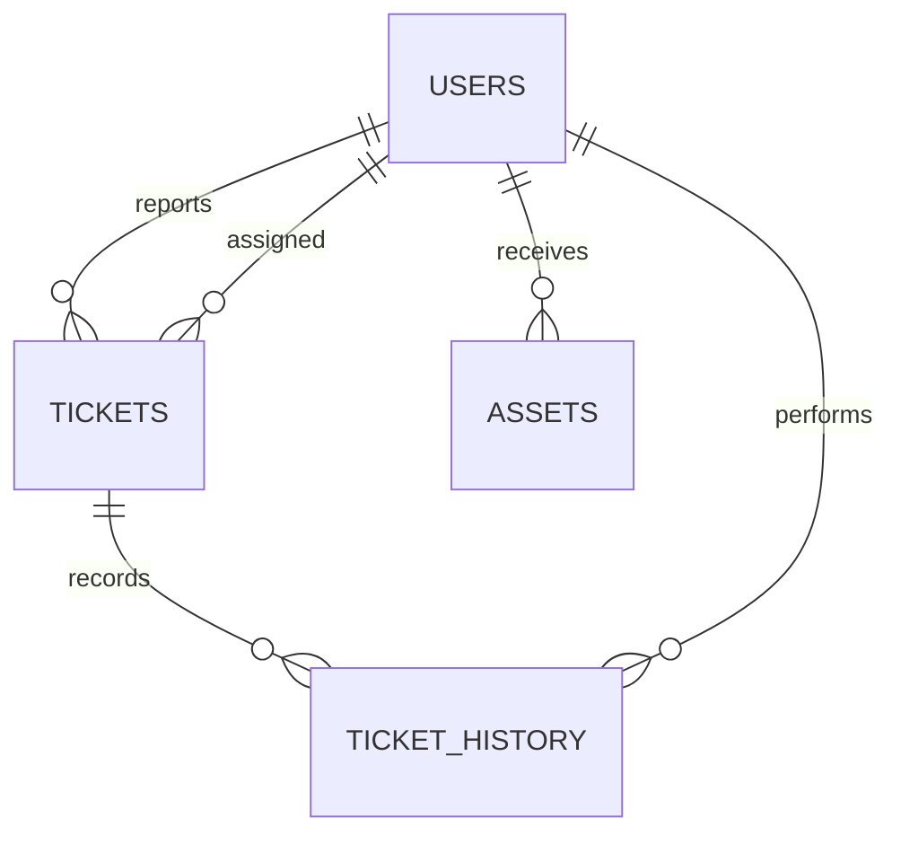

# IT Helpdesk & Asset Management

A portfolio-sized Spring Boot monolith for employee support tickets and IT operations. It uses Java 21, Maven, Thymeleaf, Spring Data JPA, MySQL, Flyway, Spring Security, and BCrypt.

## Run locally

Prerequisites: JDK 21, Maven, and Docker (or a local MySQL 8 database).

For a no-Docker demo, run `mvn spring-boot:run -Dspring-boot.run.profiles=h2`; this uses a local file-based H2 database. For the MySQL setup, start MySQL with `docker compose up -d`, then run `mvn spring-boot:run`.
Open http://localhost:8080/login.

Demo-only users are created on an empty database: `employee` / `employee123` and `technician` / `technician123`. Change or remove these before any real deployment. Configure `DB_URL`, `DB_USERNAME`, and `DB_PASSWORD` as environment variables; `.env` is not loaded automatically.

Run tests with `mvn test`. Test configuration uses an isolated H2 database and does not modify development MySQL.

## Architecture

Controllers handle web requests, services contain business operations, repositories encapsulate persistence, and JPA entities map to Flyway-managed tables. `ddl-auto=validate` ensures Hibernate does not silently change the production schema. CSRF protection is enabled by Spring Security's default form login configuration.

## Current scope and next iterations

Implemented workflows include secure login, role-aware ticket visibility, real dashboard counts, ticket creation/search/detail/status updates, resolution-note validation, persisted ticket history, asset creation/search, duplicate asset-tag protection, retired-assignment protection, migrations, Docker setup, and responsive portfolio styling. Pagination, comments, technician assignment UI, asset edit/retire UI, and full controller/database integration coverage remain future enhancements.

## Interview study map

Start with `SecurityConfig`, `TicketService`, `HomeController`, `V1__init.sql`, and `application.properties`. Explain why authorization belongs on the server, why BCrypt is used, why Flyway owns schema evolution, and why service-layer transactions keep business rules out of controllers.

## Manual test cases

| ID | Scenario | Expected |
|---|---|---|
| M-01 | Sign in with each demo account | Dashboard loads |
| M-02 | Employee creates a ticket | Ticket appears in the employee list |
| M-03 | Search by ticket title | Matching records are returned |
| M-04 | Open `/tickets` without login | User is redirected to login |

Automated test status: `mvn test` passed. The suite includes service tests for ticket creation/history persistence and the required resolution-note rule. Maven reported only a Mockito dynamic-agent warning on the installed JDK.
