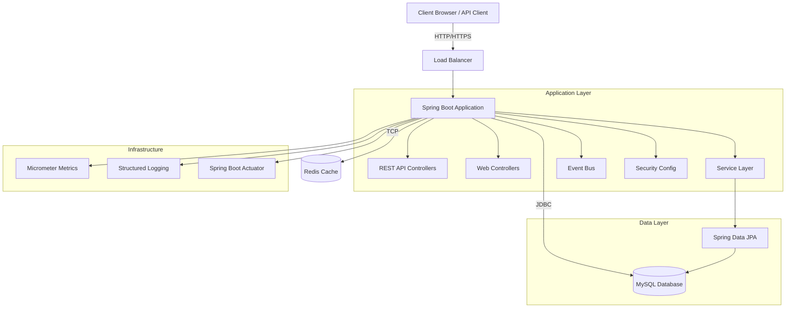
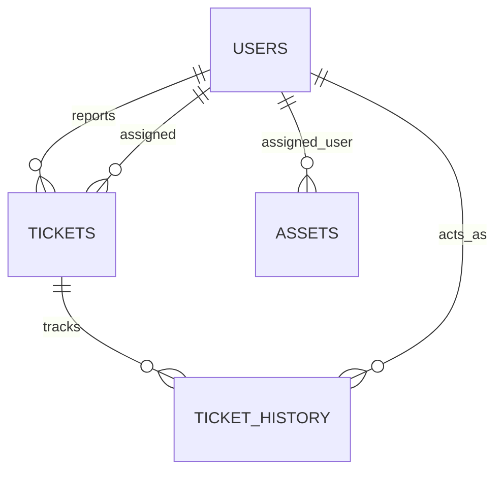
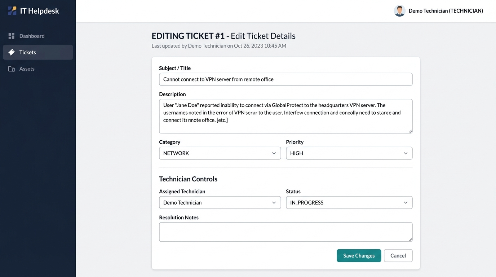
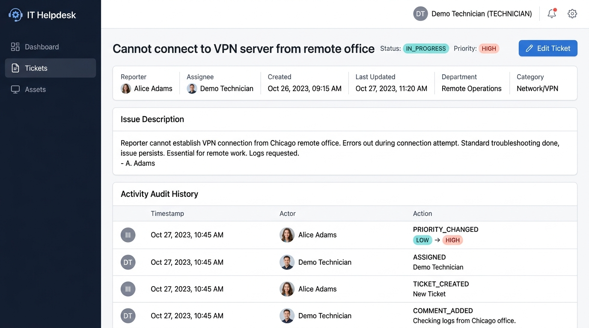

# IT Helpdesk & Asset Management System

An enterprise-grade internal IT operations and help desk monolith built with **Java 21**, **Spring Boot 3.4.4**, **Thymeleaf**, **Spring Data JPA**, **MySQL**, **Flyway**, **Redis**, and **Spring Security** with JWT authentication.

Designed to mirror realistic internal business applications at enterprise organizations, prioritizing secure role-based authorization, server-side data integrity, defense against parameter tampering, full audit trail logging, REST API with OpenAPI documentation, and robust automated test coverage.

---

## Key Features & Recent Improvements

### 6. REST API with JWT Authentication (Phase 6)
- **JWT Token Authentication**: Stateless authentication using JWT tokens with configurable expiration
- **RESTful API Endpoints**: Full CRUD operations for tickets and assets via `/api/tickets` and `/api/assets`
- **OpenAPI/Swagger Documentation**: Interactive API documentation at `/swagger-ui.html`
- **Pagination Support**: All list endpoints support pagination with configurable page size and sorting
- **Rate Limiting Ready**: Redis integration prepared for rate limiting implementation
- **Custom Business Metrics**: Micrometer metrics for tickets created/resolved/closed and assets created/assigned

### 7. Enterprise Security & Compliance
- **Security Headers**: CSP, X-Frame-Options, HSTS, and other security headers configured
- **Structured JSON Logging**: Production-ready JSON logging with Logstash encoder
- **Graceful Shutdown**: Configured graceful shutdown with 30s timeout for zero-downtime deployments
- **Database Indexing**: Comprehensive indexes on frequently queried columns for performance
- **Event-Driven Architecture**: Spring Events for asynchronous audit logging

### 1. Complete Ticket Editing & Protection (Phase 2)
- **Edit Existing Tickets**: Permitted users can update existing tickets without creating duplicates (`GET /tickets/{id}/edit`, `POST /tickets/{id}/edit`).
- **Data Integrity**: Preserves original ticket ID, reporter, and creation timestamp. The `updatedAt` timestamp is updated automatically via JPA `@PreUpdate` lifecycle triggers and service timestamps.
- **Dedicated Form DTO (`TicketEditForm`)**: Protects against Mass Assignment vulnerabilities. Sensitive internal fields (such as reporter ID and timestamps) are never bound directly from incoming HTTP form parameters.
- **Graceful Error Handling**: Nonexistent ticket IDs return an enterprise-styled 404 page rather than exposing stack traces.

### 2. Role-Based Permissions & Authorization Matrix
Security rules are enforced on the backend service layer and via Spring Security request matchers:

| Capability | Employee | Technician | Rule Enforcement |
|---|---|---|---|
| View Ticket List | **Denied** | All organization tickets | `SecurityConfig` |
| View Ticket Details | **Denied** | All organization tickets | `SecurityConfig` |
| Create Tickets | Allowed (starts `OPEN`) | Allowed | `TicketService.create` |
| Edit Title, Desc, Category, Priority | **Denied** | Allowed | `TicketService.updateTicket` |
| Assign / Reassign Technicians | **Denied** (HTTP tampering blocked) | Allowed | `TicketService.assign` & `SecurityConfig` |
| Change Ticket Status | **Denied** (HTTP tampering blocked) | Allowed (valid workflow states) | `TicketService.updateStatus` |
| Enter Resolution Notes | **Denied** | Required when `RESOLVED`/`CLOSED` | Server validation |
| Manage Assets (Add/Edit/Unassign) | **Denied** | Full management | `SecurityConfig` & `AssetService` |

Employees have a focused submission experience: after sign-in they land on the create-ticket form, and after submitting they return to that form with a confirmation. Direct requests to the dashboard, ticket queue, ticket details, edit/status endpoints, and all asset routes are denied.

### 3. Comprehensive Audit Trail & Activity History (Phase 3)
- Whenever a ticket is updated (title, description, category, priority, technician assignment, status transition, or resolution notes), an audit entry is recorded in `ticket_history`.
- Stores: `ticket_id`, `actor_id`, `action`, `details`, `field_changed`, `previous_value`, `new_value`, and `created_at`.
- Displays chronologically on the ticket detail page with clear "before and after" diff pills.
- Database evolved cleanly using Flyway migration `V2__audit_fields.sql`.

### 4. Technician Workflow & Live Metrics (Phase 4)
- **Multi-Criteria Filtering**: Filter tickets by status, priority, category, unassigned status, and keyword search.
- **Quick Actions**: Assign or reassign tickets directly from the ticket detail page with team history tracking.
- **Real-Time Operational Metrics**: Dashboard aggregates live counts from the database:
  - Open, In Progress, Resolved/Closed counts
  - High-Priority urgent queue
  - Unassigned ticket count
  - Personal queue ("My Active Assignments")
  - Registered asset count

### 5. Complete Asset Management (Phase 5)
- **Edit Existing Equipment**: Update asset tags, model name, category, manufacturer, serial number, purchase date, notes, and operational status (`GET /assets/{id}/edit`, `POST /assets/{id}/edit`).
- **Assignment & Unassignment**: Assign equipment directly to active employees; unassign equipment back into storage with a single click.
- **Duplicate Tag Protection**: Validates unique asset tags while allowing updates to the current asset (`existsByAssetTagAndIdNot`).
- **Business Rule Validation**: Prevents assigning retired equipment to users; retiring an asset automatically unassigns it.

---

## Quick Start (Docker)

### Prerequisites
- Docker and Docker Compose installed

### Steps
```bash
# Clone the repository
git clone https://github.com/KhangTran69/it-help-desk.git
cd it-help-desk

# Copy the example environment file and configure it
cp .env.example .env
# Edit .env with your secure passwords

# Build and start all services
docker-compose up --build

# Access the application at http://localhost:8080
```

### Pre-Configured Demo Accounts
- **Employee**: `employee` / `employee123`
- **Technician**: `technician` / `technician123`

---

## Architecture & Data Model

### System Architecture



### Database Schema



### Technology Stack

- **Backend**: Java 21, Spring Boot 3.4.4, Spring Security, Spring Data JPA
- **Database**: MySQL 8.0 with Flyway migrations
- **Cache**: Redis 7 (prepared for session caching and rate limiting)
- **Authentication**: JWT (JSON Web Tokens) with BCrypt password hashing
- **API Documentation**: OpenAPI 3.0 with Swagger UI
- **Monitoring**: Spring Boot Actuator with Micrometer metrics
- **Logging**: Structured JSON logging with Logstash encoder
- **Containerization**: Docker multi-stage builds with Docker Compose
- **Testing**: JUnit 5, Testcontainers for integration tests

### Architecture Patterns

- **Layered Architecture**: Controller → Service → Repository pattern
- **Event-Driven**: Spring Events for asynchronous audit logging
- **Repository Pattern**: Spring Data JPA with custom JPQL queries
- **DTO Pattern**: Separate DTOs for API and web layer to prevent mass assignment
- **Builder Pattern**: Used for complex object construction

---

## REST API Documentation

### Authentication

All API endpoints (except `/api/auth/login`) require a valid JWT token in the `Authorization` header:

```
Authorization: Bearer <your-jwt-token>
```

### Endpoints

#### Authentication

**POST `/api/auth/login`**
```json
{
  "username": "technician",
  "password": "technician123"
}
```

Response:
```json
{
  "token": "eyJhbGciOiJIUzI1NiIsInR5cCI6IkpXVCJ9...",
  "type": "Bearer",
  "username": "technician",
  "role": "TECHNICIAN",
  "fullName": "Demo Technician"
}
```

#### Tickets

**GET `/api/tickets?page=0&size=10&sortBy=updatedAt&sortDir=desc`**
- Requires: `ROLE_TECHNICIAN`
- Returns paginated list of all tickets

**GET `/api/tickets/{id}`**
- Requires: `ROLE_TECHNICIAN`
- Returns ticket details by ID

**POST `/api/tickets`**
- Requires: Authenticated user
- Creates a new ticket
```json
{
  "title": "Server overload detected",
  "description": "CPU usage at 95% for 30 minutes",
  "category": "HARDWARE",
  "priority": "HIGH"
}
```

**PUT `/api/tickets/{id}`**
- Requires: `ROLE_TECHNICIAN`
- Updates ticket details

**PATCH `/api/tickets/{id}/status?status=RESOLVED&resolutionNotes=Replaced faulty RAM`**
- Requires: `ROLE_TECHNICIAN`
- Updates ticket status

**PATCH `/api/tickets/{id}/assign?technicianId=2`**
- Requires: `ROLE_TECHNICIAN`
- Assigns ticket to technician

**GET `/api/tickets/my?page=0&size=10`**
- Requires: Authenticated user
- Returns current user's tickets

#### Assets

**GET `/api/assets?page=0&size=10&sortBy=updatedAt&sortDir=desc`**
- Requires: `ROLE_TECHNICIAN`
- Returns paginated list of all assets

**GET `/api/assets/{id}`**
- Requires: `ROLE_TECHNICIAN`
- Returns asset details by ID

**POST `/api/assets`**
- Requires: `ROLE_TECHNICIAN`
- Creates a new asset
```json
{
  "assetTag": "LAP-2024-08",
  "modelName": "MacBook Pro 14",
  "category": "Laptop",
  "manufacturer": "Apple",
  "serialNumber": "FVFX",
  "purchaseDate": "2024-01-15",
  "status": "AVAILABLE"
}
```

**PUT `/api/assets/{id}`**
- Requires: `ROLE_TECHNICIAN`
- Updates asset details

**PATCH `/api/assets/{id}/assign?userId=3`**
- Requires: `ROLE_TECHNICIAN`
- Assigns asset to user

**PATCH `/api/assets/{id}/unassign`**
- Requires: `ROLE_TECHNICIAN`
- Unassigns asset

**DELETE `/api/assets/{id}`**
- Requires: `ROLE_TECHNICIAN`
- Deletes asset

### Interactive Documentation

Visit `/swagger-ui.html` for interactive API documentation with the ability to test endpoints directly.

---

## Application Routes

| Method | Endpoint | Role | Description |
|---|---|---|---|
| `GET` | `/` | Technician | Operations Dashboard with live metrics; employees are redirected to ticket creation |
| `GET` | `/tickets` | Technician | Search & filter support tickets |
| `GET` | `/tickets/new` | Authenticated | Focused support ticket creation form |
| `POST` | `/tickets` | Authenticated | Create a new ticket; employees return to the creation form |
| `GET` | `/tickets/{id}` | Technician | Ticket detail page and chronological audit feed |
| `GET` | `/tickets/{id}/edit` | Technician | Edit ticket form (prefilled with current values) |
| `POST` | `/tickets/{id}/edit` | Technician | Submit updates to an existing ticket |
| `POST` | `/tickets/{id}/status` | Technician | Quick status transition with resolution notes |
| `POST` | `/tickets/{id}/assign` | Technician | Quick technician assignment |
| `GET` | `/assets` | Technician | Asset inventory list with search and filters |
| `GET` | `/assets/new` | Technician | Register new equipment |
| `POST` | `/assets` | Technician | Save new equipment |
| `GET` | `/assets/{id}/edit` | Technician | Edit existing equipment details |
| `POST` | `/assets/{id}/edit` | Technician | Save changes to equipment |
| `POST` | `/assets/{id}/unassign`| Technician | Unassign equipment back to storage |
| `GET` | `/login` | Public | Authentication page |
| `GET` | `/register` | Public | Employee self-registration |

---

## Running the Application Locally

### Prerequisites
- JDK 21+
- Maven 3.8+
- Docker (optional, for MySQL)

### Option 1: Quick Demo with H2 (No Docker required)
```bash
mvn spring-boot:run -Dspring-boot.run.profiles=h2
```
Access the application at [http://localhost:8080](http://localhost:8080).

### Option 2: MySQL with Docker
```bash
docker compose up -d
mvn spring-boot:run
```

### Pre-Configured Demo Accounts
- **Employee**: `employee` / `employee123`
- **Technician**: `technician` / `technician123`

---

## Automated Test Suite

Run all automated unit and integration tests:
```bash
mvn test
```

The suite covers the employee and technician authorization boundaries, ticket submission and validation, ticket filtering and workflow rules, audit history, and asset management. Run the command above for current results.

### Key Test Coverage Areas:
1. **Ticket Editing (`TicketServiceTest`)**:
   - Employees cannot reach ticket editing routes; technicians can edit ticket details.
   - Ticket ID, reporter, and creation timestamp remain immutable during technician edits.
   - Updated timestamp changes automatically when a technician saves an update.
   - Invalid titles or missing required fields are rejected.
   - Nonexistent ticket returns `ResourceNotFoundException`.
   - Ticket creation binds only employee-editable fields and sets reporter/status on the server.
2. **Security & Authorization (`TicketWebSecurityIntegrationTest`)**:
   - Unauthenticated users redirected to `/login`.
   - Employees can access ticket creation only and receive HTTP 403 for ticket queue/details/edit and all asset pages.
   - The dashboard entry redirects employees to ticket creation.
   - Technicians retain access to ticket and asset management.
   - Technician can assign and resolve tickets with required notes.
3. **Workflow & History Auditing**:
   - Changing status records `STATUS_CHANGED` with previous and new values.
   - Updating details records specific field changes (`title`, `description`, `category`, `priority`, `technician`).
   - Resolving a ticket without resolution notes is rejected with `IllegalArgumentException`.
   - Reopening and closed-ticket validation rules enforced.
4. **Asset Management (`AssetServiceTest`)**:
   - Asset editing preserves existing tags without false-positive collision errors.
   - Duplicate tags across different assets are rejected.
   - Retired assets cannot be assigned to users.
   - Equipment assignment and unassignment updates status appropriately.

---

## Manual Browser Testing Walkthrough

Follow these steps to manually test the ticket editing and permission workflow:

1. **Test Employee Ticket Submission**:
   - Log in as `employee` / `employee123`.
   - Submit a ticket titled *"Laptop Wi-Fi drops intermittently"*.
   - Verify the confirmation appears on the create-ticket page and that the page does not expose links to the dashboard, ticket list, or assets.
2. **Test Employee Permission Boundaries**:
   - While signed in as `employee`, try `/`, `/tickets`, `/tickets/1`, and `/assets` directly.
   - Verify the dashboard redirects to ticket creation and the protected ticket and asset pages return **HTTP 403 Access Denied**.
3. **Test Technician Workflow & Status Updates**:
   - Sign out and log in as `technician` / `technician123`.
   - Go to **Tickets**. Notice you can view all tickets submitted by employees.
   - Open the ticket created in Step 1.
   - In the **Quick Workflow Actions** panel:
     - Select a technician from the **Assign Technician** dropdown and click **Update Assignment**.
     - Verify the ticket updates with the assignee name and the action is recorded in history.
     - Try changing the status to `RESOLVED` with empty notes: verify you are prompted that resolution notes are required.
     - Add resolution notes *"Replaced internal Wi-Fi 6 card and updated Intel drivers."* and click **Update Status**.
     - Verify the status badge updates to `RESOLVED` and resolution notes are cleanly displayed.
4. **Test Asset Editing & Assignment**:
   - Navigate to **Assets** and click **＋ Add asset**.
   - Register a laptop: Tag `LAP-2024-08`, Name `MacBook Pro 14`, Category `Laptop`. Assign it to `employee`.
   - Click **Save Asset**. Verify the status shows `ASSIGNED` to `Demo Employee`.
   - Click **✎ Edit** on the new asset. Change the name or operational status. Verify it updates without duplicate tag errors.
   - Click **Unassign**: confirm prompt, and verify the asset status changes to `AVAILABLE` with `Unassigned` badge.

---

## Known Limitations & Future Enhancements
- **Multi-technician collaborative comments**: In addition to status changes and audit logs, a conversational comment stream could be added in a future iteration.
- **Attachment uploads**: File uploads (screenshots/system logs) could be integrated with AWS S3 or local directory storage.
- **Email notifications**: Async JavaMailSender integration for email alerts on ticket assignment and status resolution.

---

## Application UI Walkthrough

### Ticket Editing Page (`GET /tickets/{id}/edit`)
Prefilled form with core ticket metadata, server-validated fields, and role-based technician controls.



### Ticket Detail & Activity Audit Feed (`GET /tickets/{id}`)
Detailed issue overview with quick actions, real-time status badges, and chronological before/after audit history.


